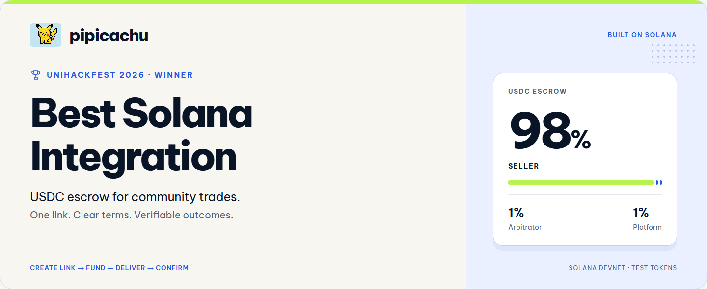
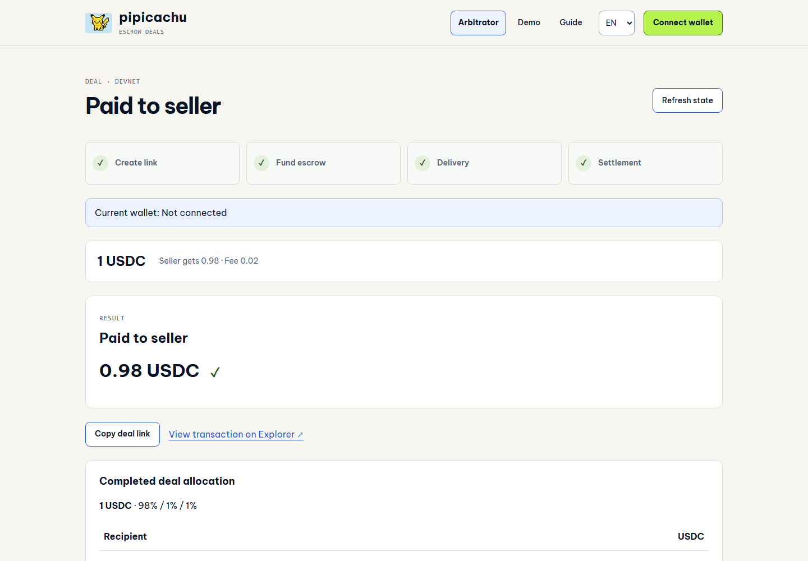
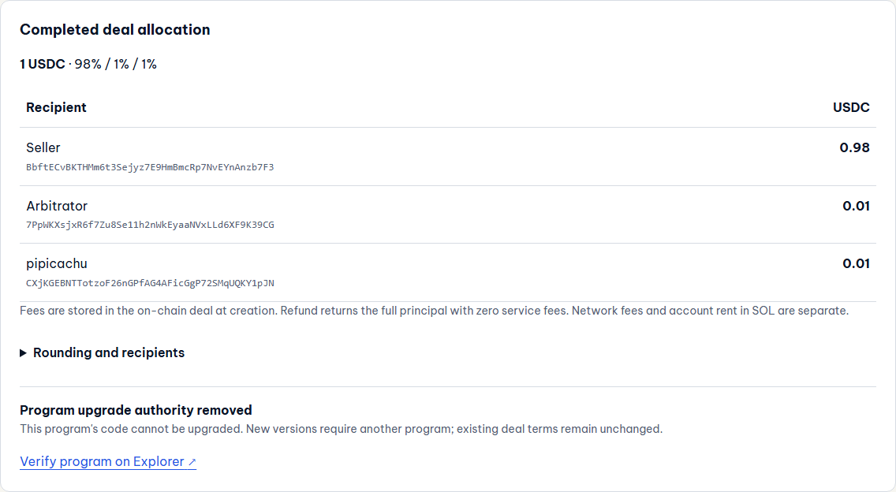
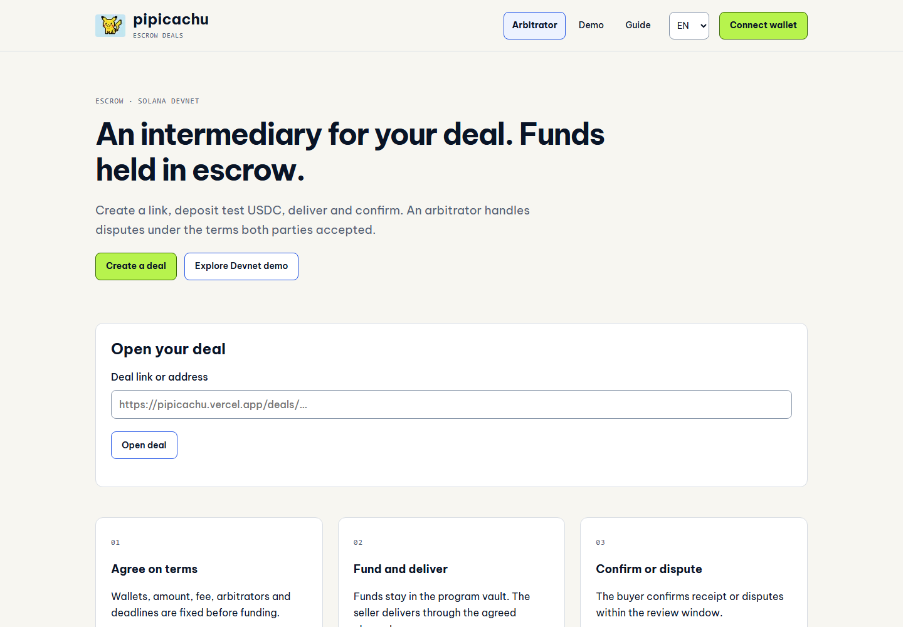
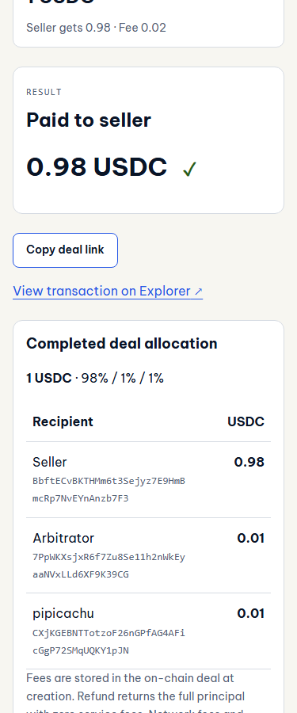
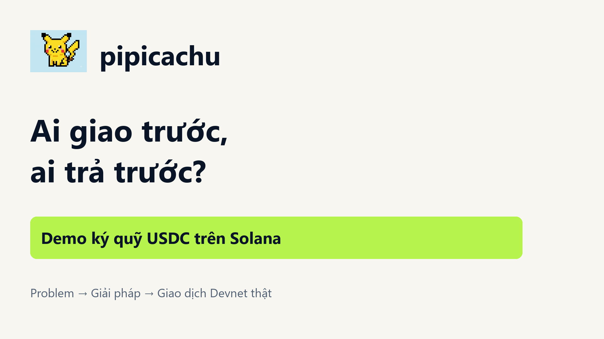
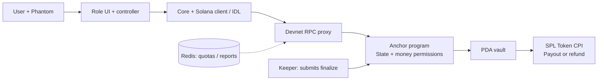

<p align="center">
  
</p>

<h1 align="center">pipicachu</h1>
<p align="center"><strong>One deal link. Three clear roles. Funds held on Solana.</strong><br>USDC escrow for people trading digital goods through communities.</p>

<p align="center">
  <a href="https://github.com/2274802010922/pipicachu/actions/workflows/quality.yml"></a>
  <a href="LICENSE"></a>
  <a href="https://pipicachu.vercel.app"></a>
  <a href="docs/evidence/fee-transparency/immutable.json"></a>
</p>

<p align="center"><a href="https://pipicachu.vercel.app"><strong>Try the product ↗</strong></a> · <a href="https://youtu.be/mTY3e3qX_4k">Watch the 2:56 demo ↗</a> · <a href="#evidence">Explore evidence</a> · <a href="README.md">Tiếng Việt</a></p>

> **Best Solana Integration — UniHackFest 2026**<br>
> pipicachu brings Solana into escrow custody, role permissions and verifiable settlement.

## Trading with someone new starts with a question of trust.

A seller wants to see the money before delivering a design template pack. The buyer wants to inspect the files before paying. A community admin can help, but holding the funds and resolving disputes often fall to the same intermediary.

**pipicachu separates custody from adjudication.** USDC stays in a program vault. The seller delivers through the agreed channel; the buyer confirms or disputes. The selected arbitrator resolves disputes under the terms agreed by both parties.

| Buyer                                                                         | Seller                                                                     | Community arbitrator                                                                      |
| ----------------------------------------------------------------------------- | -------------------------------------------------------------------------- | ----------------------------------------------------------------------------------------- |
| Reviews terms, fees and recipients before funding. Gets an inspection window. | Sees escrow funding before delivery. Follows the outcome on the same link. | Prepares bond once, enables eligible deals and handles disputes in a dedicated workspace. |

## One link. Four steps.

| Step             | Action                                                                             | Outcome                                                                            |
| ---------------- | ---------------------------------------------------------------------------------- | ---------------------------------------------------------------------------------- |
| **01 · Create**  | The seller selects an available arbitrator, buyer, amount and terms.               | An on-chain deal and shareable link.                                               |
| **02 · Fund**    | The buyer reviews the allocation and signs a USDC deposit.                         | The program checks the reviewed terms, holds funds and reserves bond capacity.     |
| **03 · Deliver** | The seller sends the goods through the agreed channel and signs the delivery note. | The buyer's inspection window begins.                                              |
| **04 · Settle**  | The buyer confirms or disputes before the deadline.                                | Settlement under the agreed conditions, or an arbitrator's payout/refund decision. |

Arbitrators are **approved, bonded and accepting in advance**. Standing consent removes per-deal acceptance signatures; the program checks available capacity at funding and releases the reservation at settlement.

## Demo

[](https://pipicachu.vercel.app/deals/5popFC7JC9YwwH6Tfrnn8zANYG86Nr953oZxvBXFnXSa)

**Running product:** [open the sample deal](https://pipicachu.vercel.app/deals/5popFC7JC9YwwH6Tfrnn8zANYG86Nr953oZxvBXFnXSa) · [finalized receipt](https://explorer.solana.com/tx/4VMbqVwmszAiqdaG3mVgbmPRcEXdDUBCMfTZ2yhsR7zYZrDd12CXzzRvsQgkMaRHAo4JYHCKivaLV9j6bEN2dwQh?cluster=devnet) · [image provenance](docs/assets/showcase/award-2026-10-13/manifest.json).

These are read-only captures of the live deployment and a **1 USDC Devnet CLI-signed fixture**, not a customer transaction. The website verifies the actual vault, mint, receiving token accounts and amounts before displaying a verified receipt.

<details>
<summary><strong>Explore the fee breakdown, home page and mobile UI</strong></summary>

**Fees and program authority read from the chain**



**Start with one link**



<p align="center"></p>

</details>

<details>
<summary><strong>Watch the real Phantom demo · 2 minutes 56 seconds</strong></summary>

[](https://youtu.be/mTY3e3qX_4k)

**v0.5 · happy path · Vietnamese narration and subtitles:** 2 USDC → 1.96 to the seller + 0.02 to the arbitrator + 0.02 to the platform. The current fee-transparency and immutable-program implementation is demonstrated by the website and receipts above.

</details>

## 98 / 1 / 1 — visible before signing

When **1 USDC** is paid out to the seller:

| Recipient  |   Share |        Amount |
| ---------- | ------: | ------------: |
| **Seller** | **98%** | **0.98 USDC** |
| Arbitrator |      1% |     0.01 USDC |
| pipicachu  |      1% |     0.01 USDC |

**One atomic settlement** transfers all three amounts and unlocks the reserved bond. Refunds return **100% of principal** with zero service fees. Network fees and SOL account rent are separate. Each fee rounds down to a USDC atom; the seller receives the remainder. Legacy deals retain their stored terms.

- **Review the actual terms:** principal, fees and recipients come from on-chain accounts.
- **Sign the reviewed terms:** `fund_reviewed` binds principal, fees, recipients, deadlines and terms with a hash checked before funding.
- **Verify the outcome:** finalized receipts are compared with actual transfers; missing evidence never becomes a verified result.

> **The Devnet program is immutable.** Upgrade authority has been permanently removed. The operator cannot upgrade this program to replace a deal's settlement logic. Future contract versions require a new Program ID; existing deals retain their program and terms.
>
> [Authority=None and CI binary proof](docs/evidence/fee-transparency/immutable.json) · [live program status](https://pipicachu.vercel.app/api/program-status) · [fee-binding design](docs/architecture/fee-transparency.md).

## Solana in the money flow

| Component                 | Product responsibility                                                                |
| ------------------------- | ------------------------------------------------------------------------------------- |
| **PDA vault**             | Holds USDC per deal, separating principal from the arbitrator's personal wallet.      |
| **SPL Token CPI**         | Executes payout/refund to fixed recipients and aggregates treasury aliases correctly. |
| **Clock & state machine** | Enforces deadlines, signer permissions, states and bond capacity in the program.      |
| **Signatures & finality** | Users hold their keys; transaction and receipt states follow chain evidence.          |
| **Immutable program**     | Deployed code has no upgrade path; the CI binary is compared with Devnet.             |

[Account constraints](programs/pipicachu-escrow/src/contexts.rs) · [settlement](programs/pipicachu-escrow/src/settlement.rs) · [reviewed funding](programs/pipicachu-escrow/src/funding.rs).

## Architecture



**The UI guides; the program enforces money permissions.** BigInt/u64 amounts, shared IDL and tests keep schema and account order aligned. [Module boundaries](docs/architecture/quality.md) · [permissions](docs/architecture/v06.md).

## Evidence

| Verified                             | Scope                                                                                      | Evidence                                                                                      |
| ------------------------------------ | ------------------------------------------------------------------------------------------ | --------------------------------------------------------------------------------------------- |
| **126 TypeScript tests**             | Amounts, codecs, permissions, fee binding, receipts and failure cases.                     | [Deployment-revision CI](https://github.com/2274802010922/pipicachu/actions/runs/38346250501) |
| **47 browser tests**                 | VI/EN, 375–1440px, keyboard/axe and mocked wallet providers.                               | [Browser harness](tests/e2e/)                                                                 |
| **Native Rust + executable SBF**     | State machine, negative cases, capacity/races, legacy and treasury aliases.                | [Program harness](scripts/checks/program.sh)                                                  |
| **6 finalized Devnet branches**      | Confirm, delivery timeout, rulings both ways, late ruling and mutual refund; CLI fixtures. | [Receipts and token deltas](docs/evidence/v06/live/acceptance.json)                           |
| **58 deals / 70 accounts preserved** | Snapshot around the final upgrade, plus one fixture verifying the 98/1/1 split.            | [Fee-transparency rollout](docs/evidence/fee-transparency/rollout.json)                       |
| **Authority=None**                   | Local/CI/deployed binaries match; authority removal is finalized.                          | [Immutable proof](docs/evidence/fee-transparency/immutable.json)                              |

Counts are tied to a revision and verification scope. Devnet transactions are not counted as customers or revenue.

## Product & engineering highlights

**Business model:** pipicachu receives 1% on seller payout; the arbitrator receives 1%. The proposed distribution channel is community admins already using USDC, introducing escrow links into existing trade channels. This describes the model and approach, not realized revenue.

<details>
<summary><strong>Explore seven product and implementation criteria</strong></summary>

### BEST PRODUCT & BUSINESS

- A specific audience: digital-goods buyers and sellers who already have Solana wallets and choose USDC, with a clear role for community admins.
- Four steps on one link, payout-based fees and a community-led distribution approach.

**Evidence:** [product scope, flow and fees](docs/product/README.md).

### BEST TECHNICAL BUILD

- State machine, checked arithmetic, principal/bond conservation, double-settlement prevention and atomic payout.
- Legacy ABI/term compatibility, recipient aliases, reviewed funding and signature checks before retry.

**Evidence:** [SBF/race/policy tests](tests/program/v06.ts) · [operations](src/escrow/operation.ts).

### Most Innovative Solution

- Program custody paired with approved arbitrators, prepaid bond and standing consent to reduce per-deal signatures.
- A shared link coordinates three parties while delivery stays in the community's existing channel.

**Evidence:** [organization flow](docs/product/organization-flow.md).

### Best Solana Integration

- PDA, SPL Token CPI, Clock and finality execute escrow responsibilities directly.
- Settlement branches have receipts; the immutable program has binary and authority evidence.

**Evidence:** [Solana constraints](programs/pipicachu-escrow/src/contexts.rs) · [immutable proof](docs/evidence/fee-transparency/immutable.json).

### Best Security & Privacy Solution

- Rust enforces signer/role/PDA/mint/recipient constraints; wallet message binding and simulation guard submission.
- The web app holds no participant keys or goods/evidence files; the RPC proxy has validation, caps and shared limits.

**Evidence:** [wallet binding](src/escrow/wallet-transaction.ts) · [RPC validation](src/backend/rpc.ts).

### Best User Experience

- Role-specific actions, visible fees before signing, short notes and transaction lifecycle feedback.
- VI/EN, 44px controls, visible focus, keyboard, responsive and axe checks.

**Evidence:** [view model](src/escrow/view-model.ts) · [fee UI tests](tests/e2e/payment-transparency.spec.ts).

### Best System Architecture

- UI/controller/core/client/backend/program boundaries; shared IDL instruction schemas.
- Pinned dependencies/lockfile and Action SHAs; native/SBF/browser checks reproduce from source.

**Evidence:** [architecture](docs/architecture/quality.md) · [Quality CI](.github/workflows/quality.yml).

</details>

## Quick start

Requires **Node.js 24** and the npm version in `package.json`.

```bash
npm ci
cp .env.example .env.local
npm run dev
```

```bash
npm run verify
# Program harness on Linux / WSL
bash scripts/checks/program.sh
```

| Guide                                     | Contents                                                            |
| ----------------------------------------- | ------------------------------------------------------------------- |
| [Deployment](docs/deployment/README.md)   | Vercel, RPC and Redis configuration.                                |
| [Reproduction](docs/testing/reproduce.md) | Running the harness and distinguishing fixtures from real receipts. |
| [Contributing](.github/CONTRIBUTING.md)   | Workflow, checks and commits.                                       |
| [Security](.github/SECURITY.md)           | Private reporting and maintained scope.                             |

<details>
<summary><strong>Devnet scope and trust model</strong></summary>

The demo uses USDC Devnet. Users sign with their own wallets; goods are delivered through the agreed external channel. Arbitrators decide disputes under the agreed terms. The immutable program is versioned by Program ID. [Permissions, settlement conditions and trust boundaries](docs/architecture/v06.md).

</details>

---

<p align="center"><strong>pipicachu</strong> · Best Solana Integration · UniHackFest 2026<br><a href="https://pipicachu.vercel.app">Website</a> · <a href="https://github.com/2274802010922/pipicachu/issues">Issues</a> · <a href="LICENSE">Apache-2.0</a> · <a href="THIRD_PARTY_NOTICES.md">Attribution & artwork</a></p>

We built the escrow program, state machine, fee binding, settlement/bond logic, client, proxy and UI. Infrastructure uses Anchor, Solana SDK/SPL Token, Next.js and Phantom. The pixel logo retains its separate artwork licensing scope.
