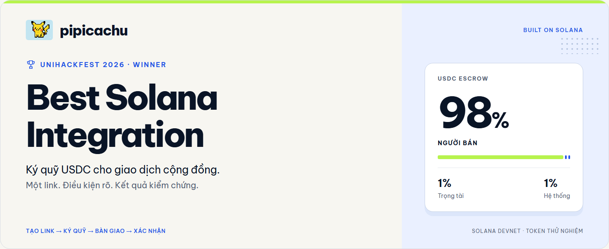
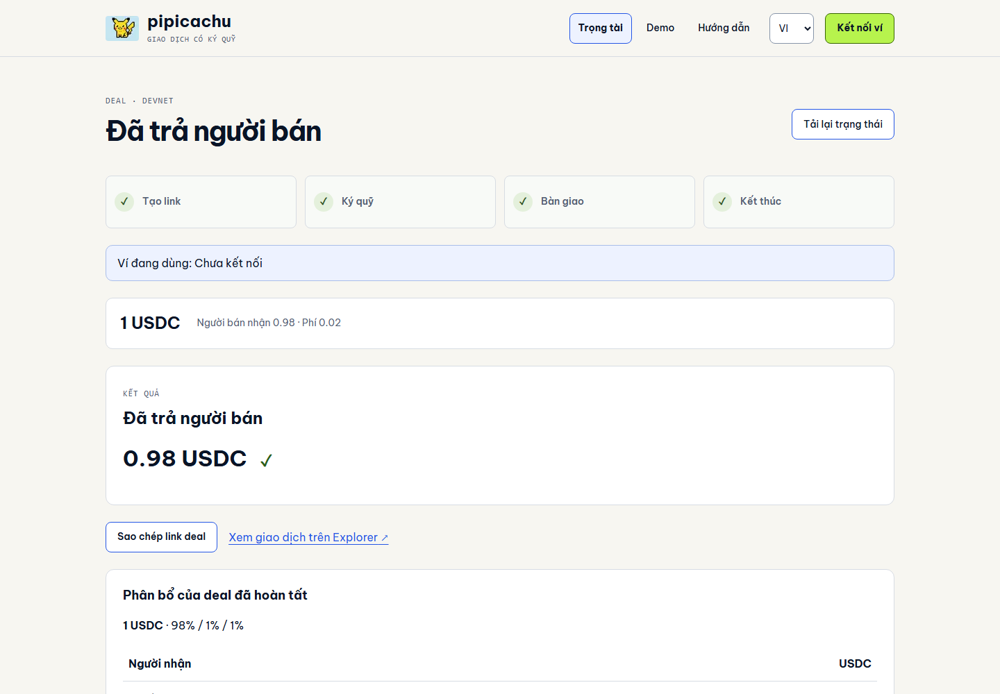
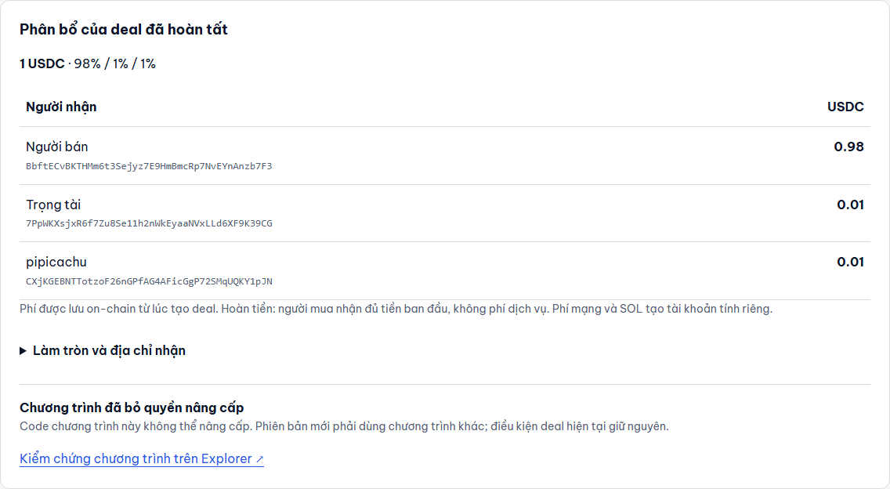
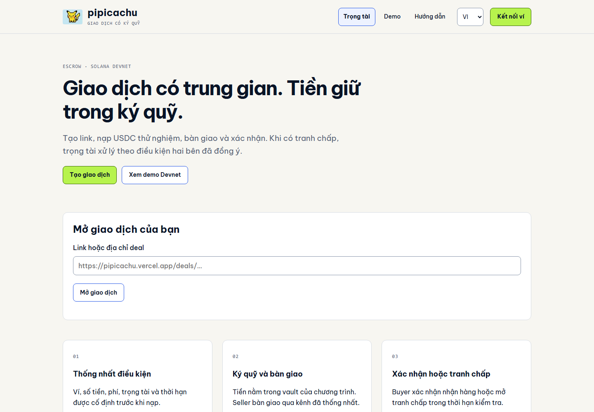
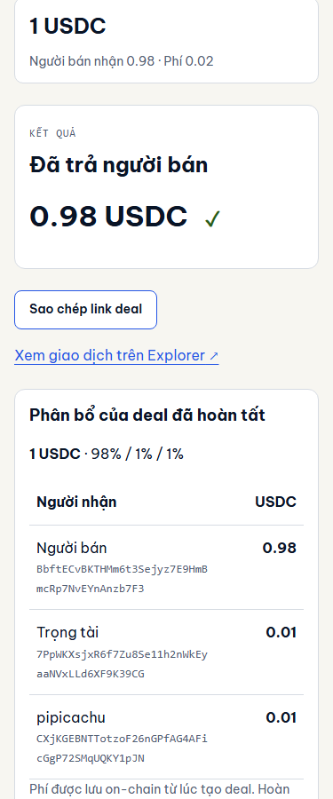
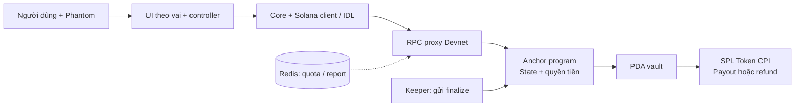

<p align="center">
  
</p>

<h1 align="center">pipicachu</h1>
<p align="center"><strong>Một link giao dịch. Ba bên cùng rõ. Tiền được giữ trên Solana.</strong><br>Ký quỹ USDC cho người mua/bán sản phẩm số qua cộng đồng.</p>

<p align="center">
  <a href="https://github.com/2274802010922/pipicachu/actions/workflows/quality.yml"></a>
  <a href="LICENSE"></a>
  <a href="https://pipicachu.vercel.app"></a>
  <a href="docs/evidence/fee-transparency/immutable.json"></a>
</p>

<p align="center"><a href="https://pipicachu.vercel.app"><strong>Dùng thử sản phẩm ↗</strong></a> · <a href="https://youtu.be/mTY3e3qX_4k">Xem video 2:56 ↗</a> · <a href="#evidence">Xem bằng chứng</a> · <a href="README.en.md">English</a></p>

> **Best Solana Integration — UniHackFest 2026**<br>
> Thành tích của pipicachu: đưa Solana vào luồng ký quỹ, phân quyền và giải ngân có thể kiểm chứng.

## Giao dịch với người chưa từng quen, bắt đầu từ đâu?

Người bán một bộ template muốn thấy tiền trước khi giao file. Người mua muốn kiểm tra file trước khi trả tiền. Admin cộng đồng có thể hỗ trợ, nhưng tiền và việc xử tranh chấp thường cùng nằm trong tay một người trung gian.

**pipicachu tách việc giữ tiền khỏi việc phán quyết.** USDC nằm trong vault của chương trình; người bán giao qua kênh đã thống nhất. Người mua xác nhận hoặc mở tranh chấp. Trọng tài được chọn xử lý theo điều kiện hai bên đã chốt.

| Người mua                                                                | Người bán                                                             | Trọng tài cộng đồng                                                         |
| ------------------------------------------------------------------------ | --------------------------------------------------------------------- | --------------------------------------------------------------------------- |
| Xem điều kiện, phí và ví nhận trước khi nạp. Có thời gian kiểm tra hàng. | Thấy tiền đã vào quỹ trước khi giao. Theo dõi kết quả trên cùng link. | Chuẩn bị cọc một lần, bật nhận deal và xử tranh chấp trong workspace riêng. |

## Một link. Bốn bước.

| Bước              | Thao tác                                                                 | Điều xảy ra                                                           |
| ----------------- | ------------------------------------------------------------------------ | --------------------------------------------------------------------- |
| **01 · Tạo link** | Người bán chọn trọng tài khả dụng, nhập người mua, số tiền và điều kiện. | Deal và link chia sẻ được tạo on-chain.                               |
| **02 · Ký quỹ**   | Người mua kiểm bảng phí và ký nạp USDC.                                  | Program kiểm đúng điều kiện đã xem, giữ tiền trong vault và dành cọc. |
| **03 · Bàn giao** | Người bán gửi hàng qua kênh đã thống nhất rồi ký ghi nhận bàn giao.      | Bắt đầu thời gian người mua kiểm tra.                                 |
| **04 · Kết thúc** | Người mua xác nhận hoặc khiếu nại trước hạn.                             | Payout theo điều kiện, hoặc trọng tài quyết định payout/refund.       |

Trọng tài **được duyệt, nạp cọc và bật nhận trước**. Standing consent giúp bỏ lượt ký nhận riêng cho từng deal; program kiểm capacity khi người mua nạp và mở cọc khi kết thúc.

## Demo

[](https://pipicachu.vercel.app/deals/5popFC7JC9YwwH6Tfrnn8zANYG86Nr953oZxvBXFnXSa)

**Sản phẩm đang chạy:** [mở deal mẫu](https://pipicachu.vercel.app/deals/5popFC7JC9YwwH6Tfrnn8zANYG86Nr953oZxvBXFnXSa) · [receipt finalized](https://explorer.solana.com/tx/4VMbqVwmszAiqdaG3mVgbmPRcEXdDUBCMfTZ2yhsR7zYZrDd12CXzzRvsQgkMaRHAo4JYHCKivaLV9j6bEN2dwQh?cluster=devnet) · [nguồn ảnh](docs/assets/showcase/award-2026-10-13/manifest.json).

Ảnh chụp bản deploy thật, đọc một giao dịch thử **1 USDC Devnet**, ký bằng CLI; không phải giao dịch khách hàng. Website đối chiếu transfer với đúng vault, mint, token account và số tiền trước khi hiện nhãn đã xác minh.

<details>
<summary><strong>Xem bảng phí, trang chủ và giao diện mobile</strong></summary>

**Phí và trạng thái chương trình đọc từ on-chain**



**Bắt đầu từ một link**



<p align="center"></p>

</details>

<details>
<summary><strong>Xem video demo Phantom thật · 2 phút 56 giây</strong></summary>

[](https://youtu.be/mTY3e3qX_4k)

Video **v0.5 · happy path · giọng nam và phụ đề Việt**: 2 USDC → 1,96 người bán + 0,02 trọng tài + 0,02 hệ thống. Phần minh bạch phí và immutable mới nhất được trình bày bằng website/receipt ở trên.

</details>

## 98 / 1 / 1 — minh bạch trước khi ký

Với **1 USDC** được giải ngân cho người bán:

| Người nhận    |   Tỷ lệ |       Số tiền |
| ------------- | ------: | ------------: |
| **Người bán** | **98%** | **0,98 USDC** |
| Trọng tài     |      1% |     0,01 USDC |
| pipicachu     |      1% |     0,01 USDC |

**Một atomic settlement** chuyển cả ba khoản và mở phần cọc tương ứng. Refund trả **100% principal**, phí dịch vụ bằng 0. Phí mạng và rent SOL tính riêng; mỗi phí làm tròn xuống đến atom USDC, phần dư thuộc người bán. Deal legacy giữ điều kiện đã lưu.

- **Xem đúng điều kiện:** số tiền, phí và ví nhận được đọc từ account on-chain.
- **Ký đúng điều kiện:** `fund_reviewed` đối chiếu hash của principal, phí, người nhận, thời hạn và terms trước khi nhận tiền.
- **Kiểm chứng kết quả:** receipt finalized được đối chiếu với transfer thực tế; thiếu dữ liệu không được báo đã xác minh.

> **Program Devnet đã immutable.** Upgrade authority đã được bỏ vĩnh viễn. Chủ dự án không thể nâng cấp program này để thay logic chia tiền của các deal. Đổi smart contract về sau cần Program ID mới; deal hiện hữu giữ nguyên chương trình và điều kiện.
>
> [Bằng chứng authority=None và binary CI](docs/evidence/fee-transparency/immutable.json) · [trạng thái live](https://pipicachu.vercel.app/api/program-status) · [thiết kế binding phí](docs/architecture/fee-transparency.md).

## Solana trong luồng tiền

| Thành phần                | Vai trò trong sản phẩm                                                               |
| ------------------------- | ------------------------------------------------------------------------------------ |
| **PDA vault**             | Giữ USDC theo từng deal, tách principal khỏi ví cá nhân của trọng tài.               |
| **SPL Token CPI**         | Thực thi payout/refund tới recipient cố định; gộp đúng khi treasury trùng một role.  |
| **Clock & state machine** | Kiểm thời hạn, quyền ký, trạng thái và khả năng nhận deal ngay trong program.        |
| **Chữ ký & finality**     | Người dùng giữ khóa; ứng dụng đối chiếu transaction và receipt theo bằng chứng mạng. |
| **Immutable program**     | Code đã triển khai không còn đường nâng cấp; binary CI được đối chiếu với Devnet.    |

[Account constraints](programs/pipicachu-escrow/src/contexts.rs) · [settlement](programs/pipicachu-escrow/src/settlement.rs) · [reviewed funding](programs/pipicachu-escrow/src/funding.rs).

## Architecture



**UI hướng dẫn. Program quyết định quyền tiền.** BigInt/u64 cho số lượng tài sản; IDL và tests giữ schema/account order nhất quán. [Ranh giới module](docs/architecture/quality.md) · [mô hình quyền](docs/architecture/v06.md).

## Evidence

| Đã kiểm                             | Phạm vi                                                                             | Mở bằng chứng                                                                                |
| ----------------------------------- | ----------------------------------------------------------------------------------- | -------------------------------------------------------------------------------------------- |
| **126 test TypeScript**             | Amounts, codecs, quyền, fee binding, receipt và các ca lỗi.                         | [CI của bản triển khai](https://github.com/2274802010922/pipicachu/actions/runs/38346250501) |
| **47 browser tests**                | VI/EN, 375–1440px, keyboard/axe và wallet provider mô phỏng.                        | [Harness trình duyệt](tests/e2e/)                                                            |
| **Native Rust + executable SBF**    | State machine, negative cases, capacity/race, legacy và treasury alias.             | [Program harness](scripts/checks/program.sh)                                                 |
| **6 nhánh Devnet finalized**        | Confirm, timeout giao hàng, ruling hai hướng, xử muộn, mutual refund; CLI fixtures. | [Receipt và token delta](docs/evidence/v06/live/acceptance.json)                             |
| **58 deal / 70 account giữ nguyên** | Snapshot trước/sau lần upgrade cuối; thêm một fixture kiểm chia 98/1/1.             | [Rollout minh bạch phí](docs/evidence/fee-transparency/rollout.json)                         |
| **Authority=None**                  | Binary local/CI/deployed khớp; giao dịch bỏ quyền đã finalized.                     | [Proof immutable](docs/evidence/fee-transparency/immutable.json)                             |

Số liệu gắn với revision và phạm vi kiểm chứng; giao dịch Devnet không được tính là khách hàng hay doanh thu.

## Điểm mạnh sản phẩm & kỹ thuật

**Mô hình kinh doanh:** pipicachu thu 1% khi payout; trọng tài nhận 1%. Hướng tiếp cận là hợp tác với admin cộng đồng đã dùng USDC, đưa link ký quỹ vào kênh mua bán hiện có. Đây là mô hình và hướng tiếp cận, không phải tuyên bố doanh thu đã có.

<details>
<summary><strong>Đọc sâu hơn qua 7 tiêu chí sản phẩm và triển khai</strong></summary>

### BEST PRODUCT & BUSINESS

- Nhóm dùng cụ thể: người mua/bán sản phẩm số đã có ví Solana và chọn USDC; giá trị rõ cho cả ba vai.
- Bốn bước trên cùng link; cơ chế phí gắn với payout và hướng tiếp cận qua admin cộng đồng.

**Bằng chứng:** [phạm vi, flow và phí](docs/product/README.md).

### BEST TECHNICAL BUILD

- State machine, checked arithmetic, bảo toàn principal/cọc, chống chi lặp và atomic settlement.
- Giữ ABI/điều kiện legacy; xử lý alias recipient, reviewed funding và kiểm signature trước retry.

**Bằng chứng:** [SBF/race/policy tests](tests/program/v06.ts) · [operation](src/escrow/operation.ts).

### Most Innovative Solution

- Kết hợp program custody với trọng tài được duyệt; cọc sẵn và standing consent giảm lượt ký từng deal.
- Một link phối hợp ba bên, giữ quy trình trao hàng qua cộng đồng và đưa luồng tiền lên chain.

**Bằng chứng:** [organization flow](docs/product/organization-flow.md).

### Best Solana Integration

- PDA, SPL Token CPI, Clock và finality trực tiếp thực thi nghiệp vụ ký quỹ.
- Các nhánh giải ngân có receipt; program immutable có binary và authority proof để đối chiếu.

**Bằng chứng:** [Solana constraints](programs/pipicachu-escrow/src/contexts.rs) · [immutable](docs/evidence/fee-transparency/immutable.json).

### Best Security & Privacy Solution

- Kiểm signer/role/PDA/mint/recipient trong Rust; message binding và simulation trước gửi.
- Web không giữ khóa của các role, không nhận file hàng/bằng chứng; RPC có caps và shared limiter.

**Bằng chứng:** [wallet binding](src/escrow/wallet-transaction.ts) · [RPC validation](src/backend/rpc.ts).

### Best User Experience

- Đúng vai, đúng hành động, phí rõ trước ký; ghi chú ngắn và feedback theo vòng đời transaction.
- VI/EN, controls tối thiểu 44px, focus/bàn phím, responsive và axe trong browser harness.

**Bằng chứng:** [view model](src/escrow/view-model.ts) · [fee UI tests](tests/e2e/payment-transparency.spec.ts).

### Best System Architecture

- Tách UI/controller/core/client/backend/program; IDL là nguồn chung cho instruction schema.
- Dependency/lockfile và CI Actions pin; native/SBF/browser checks có thể tái hiện từ source.

**Bằng chứng:** [architecture](docs/architecture/quality.md) · [Quality CI](.github/workflows/quality.yml).

</details>

## Quick start

Yêu cầu **Node.js 24** và npm theo `package.json`.

```bash
npm ci
cp .env.example .env.local
npm run dev
```

```bash
npm run verify
# Program harness trên Linux / WSL
bash scripts/checks/program.sh
```

| Tài liệu                                       | Nội dung                                             |
| ---------------------------------------------- | ---------------------------------------------------- |
| [Triển khai](docs/deployment/README.md)        | Cấu hình Vercel, RPC và Redis.                       |
| [Tái hiện kiểm thử](docs/testing/reproduce.md) | Cách chạy harness và phân biệt fixture/receipt thật. |
| [Đóng góp](.github/CONTRIBUTING.md)            | Workflow, kiểm thử và commit.                        |
| [Bảo mật](.github/SECURITY.md)                 | Kênh báo lỗi riêng và phạm vi được duy trì.          |

<details>
<summary><strong>Phạm vi Devnet và mô hình tin cậy</strong></summary>

Demo dùng USDC Devnet. Người dùng tự ký bằng ví; hàng được giao qua kênh đã thống nhất. Trọng tài phán quyết theo điều kiện các bên chấp thuận. Program immutable được phân phiên bản bằng Program ID. [Quyền hạn, điều kiện giải ngân và mô hình tin cậy](docs/architecture/v06.md).

</details>

---

<p align="center"><strong>pipicachu</strong> · Best Solana Integration · UniHackFest 2026<br><a href="https://pipicachu.vercel.app">Website</a> · <a href="https://github.com/2274802010922/pipicachu/issues">Issues</a> · <a href="LICENSE">Apache-2.0</a> · <a href="THIRD_PARTY_NOTICES.md">Ghi công & artwork</a></p>

Tự xây program escrow, state machine, fee binding, settlement/cọc, client, proxy và UI. Hạ tầng dùng Anchor, Solana SDK/SPL Token, Next.js và Phantom. Logo pixel giữ phạm vi giấy phép artwork riêng.
